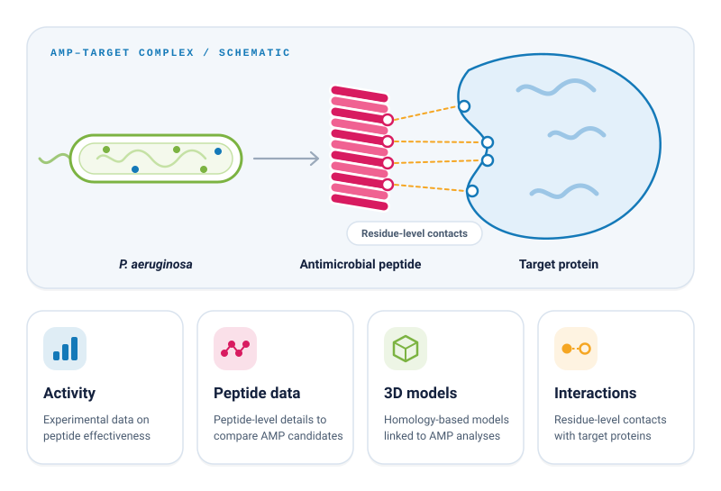

### Curated Antimicrobial Peptides Targeting *Pseudomonas aeruginosa*

A curated database resource for experimentally reported antimicrobial peptides, their structural models, and residue-level interactions with target proteins.

<h2></h2>

**PAAMPdb** is a curated database resource specializing in experimentally reported antimicrobial peptides (AMPs) targeting *Pseudomonas aeruginosa*. The database brings together curated experimental information on reported AMPs, including antimicrobial effectiveness, peptide-related information, structural models, and residue-level interactions between AMPs and target proteins.

  

<h2></h2>

| Resource | Link |
|---|---|
| 🌐 **Web database** | [mgbio.asab.nust.edu.pk/paampdb](https://mgbio.asab.nust.edu.pk/paampdb/) |
| 🔎 **Search AMP–target proteins** | [Open search](https://mgbio.asab.nust.edu.pk/paampdb/search/) |
| 📊 **Database statistics** | [View statistics](https://mgbio.asab.nust.edu.pk/paampdb/stats/) |
| 💻 **Source code** | [github.com/samavinasir/paampdb](https://github.com/samavinasir/paampdb) |

<h2></h2>

| | Feature | Description |
|---|---|---|
| 🧬 | **Curated AMP information** | Provides curated information on antimicrobial peptides reported against *P. aeruginosa*. |
| 🧪 | **Antimicrobial activity** | Includes experimental information describing the antimicrobial effectiveness of reported peptides. |
| 📋 | **Peptide information** | Provides relevant peptide-level information for exploring and comparing AMP candidates. |
| 🔬 | **Structural models** | Includes a range of homology-based structural models associated with AMP-related analyses. |
| 🔗 | **AMP–target interactions** | Provides residue-level information describing interactions between antimicrobial peptides and their target proteins. |
| 🔎 | **Search and exploration** | Enables users to explore the curated database and identify AMPs of interest for further investigation. |

<h2></h2>

PAAMPdb is intended to support research in:

- 💊 **Antimicrobial peptide discovery**
- 🦠 ***P. aeruginosa*** **research**
- 🛡️ **Antimicrobial resistance studies**
- 🔗 **AMP–protein interaction analysis**
- 🧱 **Structural bioinformatics**
- 🎯 **Therapeutic target exploration**
- 🌱 **Development of alternative antimicrobial strategies**

<h2></h2>

> The database focuses specifically on ***Pseudomonas aeruginosa***, an important bacterial pathogen associated with antimicrobial resistance and clinically relevant infections.

<h2></h2>

If you use PAAMPdb in your research, please cite the associated publication when available.

<h2></h2>

PAAMPdb is developed and maintained by the **Microbial Genomics & Bioinformatics Research Group (MGB)**, Atta-ur-Rahman School of Applied Biosciences (ASAB), National University of Sciences and Technology (NUST), Islamabad, Pakistan.

- 🌐 **Database:** [mgbio.asab.nust.edu.pk/paampdb](https://mgbio.asab.nust.edu.pk/paampdb/)
- ✉️ **Contact page:** [mgbio.asab.nust.edu.pk/paampdb/contact](https://mgbio.asab.nust.edu.pk/paampdb/contact/)
- 💻 **GitHub:** [samavinasir/paampdb](https://github.com/samavinasir/paampdb)

<h2></h2>

PAAMPdb is licensed under the Apache License 2.0.

See the [LICENSE](LICENSE) file for the full license text.

---

**Built for accessible, data-driven antimicrobial peptide research.**

PAAMPdb · Antimicrobial Peptides · *Pseudomonas aeruginosa* · NUST Islamabad

